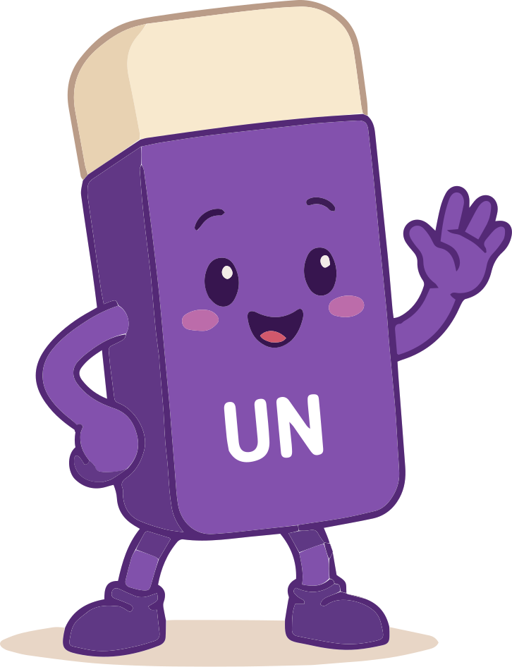

# @equal-lens/brand

The Equal Lens design system in one installable package: the colour palette,
fonts, the kid/adult (light/dark) theme, the playful CSS UI kit (dotted paper,
"sticker" cards, motion), **React components** for the atoms & molecules, and
the brand SVG assets. Plain CSS needs no build step or dependency; the React
components need only React.

> This is the single source of truth. The Equal Lens site **consumes** this
> package (`import { Button } from "@equal-lens/brand"`) rather than defining
> these styles internally — so a change here updates the site and any other
> project at once.

## Install
```sh
npm i @equal-lens/brand        # or: pnpm add @equal-lens/brand
```
React is a peer dependency (>=18). Inside this monorepo the site links it as a
workspace package (`"@equal-lens/brand": "workspace:*"`); `pnpm install` builds
it automatically (`prepare` script).

## What's in here
| Entry | Use |
|---|---|
| `@equal-lens/brand` | **React components** + class helpers + typed `tokens` (built to `dist/`) |
| `@equal-lens/brand/styles.css` | one-file plain-CSS bundle (fonts + tokens + utilities + components) |
| `@equal-lens/brand/components.css` | just the atoms & molecules (the UI-kit classes) |
| `@equal-lens/brand/tokens.css` | the colour + font CSS variables (+ the dark-theme flip) |
| `@equal-lens/brand/tailwind.css` | **Tailwind v4 version** — registers the palette as `bg-brand`, `text-ink`, `font-hand`, … |
| `@equal-lens/brand/tokens.json` | the tokens as data (design tools) |
| `@equal-lens/brand/assets/*` | **the brand SVGs** — logo, mascots, Lensy poses, ship, doodles (see below) |
| `preview.html` / `components.html` | open in a browser to see the palette + assets + the live UI kit |

## Quick start

**React (the way the site uses it):**
```tsx
import "@equal-lens/brand/components.css";          // once, in your root layout
import { Button, Card, Tabs, navLinkClass } from "@equal-lens/brand";

<Button variant="primary" onClick={…}>Get started</Button>
<Card soft>…</Card>
```
The components are stateless/presentational — safe in React Server Components;
add `"use client"` in your own file when you pass handlers. See **Atoms &
molecules** below for the full list.

**Plain CSS (any project, any framework):**
```html
<link rel="stylesheet" href="node_modules/@equal-lens/brand/equal-lens.css" />
<button class="btn btn--primary">Get started</button>
```

**Tailwind v4:** in your entry CSS, after `@import "tailwindcss";`, add
`@import "@equal-lens/brand/tailwind.css";` (palette → `bg-brand text-ink
font-hand …` + the dark flip) and `@import "@equal-lens/brand/components.css";`
for the `.btn`/`.card`/… classes.

**JS/TS tokens:**
```ts
import { tokens } from "@equal-lens/brand";
tokens.light.brand;  // "#553286"
tokens.dark.paper;   // "#15101F"
```

## Light / dark (the "kid / adult" theme)
The palette ships light by default. To switch to dark, put `data-audience="adult"`
on a parent (usually `<html>`):
```html
<html data-audience="adult">   <!-- dark -->
<html>                          <!-- light (default) -->
```
Only a handful of tokens flip (`paper`, `surface`, `mist`, `ink`, `brand`,
`brandsoft`, `band`, `dot`); the violet ramp and accents stay. Prefer a
different convention? Find-and-replace `[data-audience="adult"]` with `.dark`
or `[data-theme="dark"]` in `tokens.css` / `tailwind.css`.

## Palette
**Equal Violet `#553286`** leads; neutrals carry; accents appear in small doses.

| Token | Light | Dark | Use |
|---|---|---|---|
| `--color-brand` | `#553286` | `#C9B8E6` | primary violet |
| `--color-brandsoft` | `#7F65A4` | `#B3A4D6` | muted violet |
| `--color-paper` | `#FBF9FF` | `#15101F` | page background |
| `--color-surface` | `#FFFFFF` | `#221A30` | cards |
| `--color-mist` | `#E7E0F1` | `#3A2E4D` | lines / hover |
| `--color-ink` | `#221436` | `#F1ECFA` | text + outlines |
| `--color-band` | `#553286` | `#241B38` | footer / CTA band |
| `--dot` | `#ECE6F6` | `#2A2140` | dotted-paper texture |
| `--color-insight` | `#2DD4BF` | — | teal · "unlearn" |
| `--color-grow` | `#FF7A5C` | — | coral · "relearn" / CTA |
| `--color-sun` | `#FFC94D` | — | yellow · CTA (always with `ink` text) |
| `--color-sky` | `#4FB0E8` | — | blue · support |

Full violet ramp: `--color-violet-50…900`.

## Type
- `--font-display` **Poppins** — wordmark, UI labels
- `--font-body` **Nunito Sans** — body copy
- `--font-hand` **Baloo 2** — headlines + playful / mascot voice

## Utility classes
- `.sticker` — chunky 2.5px outline + hard 4px offset shadow (the cut-out card look). `.sticker-soft` is the violet variant.
- dotted-paper background is applied to `body`; `.canvas-dots` puts the same texture on any element.
- motion: `.anim-float` `.anim-wobble` `.anim-bob` `.anim-pop` and `.hover-pop` (lift + tilt on hover). All respect `prefers-reduced-motion`.

## Atoms & molecules
Two ways to use the same kit — **React components** (import from
`@equal-lens/brand`) or the underlying **CSS classes** (`components.css`). The
components just apply the classes, so they're interchangeable.
**Open `components.html` to see them all rendered.**

| Component | Class (CSS) | Notes |
|---|---|---|
| `<Button variant size href>` | `.btn .btn--{primary\|sun\|outline\|band\|solid\|ghost}` `.btn--sm` | `band` = white-on-dark, `solid` = flat (forms); `href` → `<a>` |
| `<Tag>` `<Eyebrow>` | `.tag` · `.eyebrow` | label pill / uppercase mini-label |
| `<Card soft>` | `.card` `.card--soft` | the sticker card |
| `<Note tone>` `<NoteChip truth>` | `.note .note--{yellow\|mint\|peach\|violet}` · `.note__chip` | sticky note + status chip |
| `<Segmented options value onChange>` | `.segmented` `.segmented__option` | Kids / Adult toggle |
| `<NavLink active href>` | `.nav-link` | header nav pill |
| `<Tabs items value onChange>` | `.tabs` `.tab` `.tab__icon` | pill-tab row |
| `<Toolbar dock>` `<ToolbarButton active>` `<ToolbarSeparator>` | `.toolbar` `.toolbar--dock` `.toolbar__btn` `.toolbar__sep` | bottom tool pill |
| `<ShipDock src>` | `.ship-bubble` | Lensy's round ship dock |
| `<Popover>` `<Bubble>` | `.popover` · `.bubble` | chat card + speech bubble |

Prefer to style your **own** element (e.g. a Next.js `<Link>`)? Use the class
helpers instead of the components: `buttonClass({ variant, size })`,
`navLinkClass(active)`, `tabClass(active)`, `cardClass(soft)`, `noteClass(tone)`,
`segmentedOptionClass(active)`, `toolbarButtonClass(active)` — that's exactly how
the site styles its router links. Active/selected states map to ARIA
(`aria-pressed`/`aria-selected`/`aria-current`) or an `.is-active` class, so the
raw classes work in any framework.

### CSS class reference
**Atoms**
- `.btn` + `.btn--primary` (violet) · `.btn--sun` · `.btn--outline` (violet sticker) · `.btn--band` (white outline, for dark CTA bands) · `.btn--solid` (flat fill, no sticker — forms) · `.btn--ghost` (text only); add `.btn--sm` for compact. Pill shape, hand font, lift-on-hover, `:disabled` dims.
- `.tag` — the shadowed pill label that sits above headings. `.eyebrow` — the uppercase mini-label (no box).
- `.card` — the signature sticker card; `.card--soft` is the violet-shadow variant.
- `.note` — a sticky note; pair with a tone: `.note--yellow` `.note--mint` `.note--peach` `.note--violet` (each flips in dark). `.note__chip` / `.note__chip--truth` is the status chip.

**Molecules**
- `.segmented` + `.segmented__option` — the Kids / Adult (light/dark) toggle. Mark the on option `aria-pressed="true"` or `.is-active`.
- `.nav-link` — header nav pills; current page = `aria-current="page"` or `.is-active`.
- `.tabs` + `.tab` (+ `.tab__icon`) — the pill-tab row that switches a panel. Selected = `aria-selected="true"` or `.is-active`.
- `.toolbar` (+ `.toolbar--dock` to pin it bottom-centre) with `.toolbar__btn` and `.toolbar__sep` — the floating bottom tool pill.
- `.ship-bubble` — Lensy's round ship dock (drop a `ship-*.svg` inside).
- `.popover` + `.bubble` — Lensy's chat card and its speech bubble.

```html
<button class="btn btn--primary">Get started</button>
<div class="card hover-pop"> … </div>
<div class="toolbar toolbar--dock">
  <button class="toolbar__btn is-active">Browse</button>
  <button class="toolbar__btn"> Unlearn</button>
</div>
```

> **Using Tailwind?** These class names are plain CSS and don't depend on
> Tailwind — just `@import "@equal-lens/brand/components.css";` in your entry
> stylesheet (order doesn't matter; they read the same tokens).

## Brand assets — `assets/`
All SVG, transparent background, recolorable. Bundled here so the package is
self-contained (no need to reach back into the main site repo).

| Folder | Files | What |
|---|---|---|
| `assets/logo/` | `logo-primary.svg` · `logo-reversed.svg` · `logo-mono.svg` · `avatar-violet.svg` · `avatar-light.svg` | the **eQ mark** — violet, white (for dark bg), black, and two square avatar lockups |
| `assets/mascots/` | `un.svg` · `re.svg` | the **Unlearn / Relearn** character pair |
| `assets/lensy/` | `lensy-wave.svg` · `lensy-stand.svg` · `lensy-think.svg` · `lensy-idea.svg` · `lensy-icon.svg` | **Lensy**, the magnifying-glass mascot, in five poses (`-icon` is the compact face) |
| `assets/ship/` | `ship-closed.svg` · `ship-flying.svg` · `ship-front.svg` · `ship-diagonal.svg` | the **ship** illustration, four angles |
| `assets/doodles/` | `squiggle` · `sparkle` · `spiral` · `arrow` · `heart` · `star` · `zigzag` · `swirl` `.svg` | the hand-drawn **doodle set** (filled in brand violet `#553286` — change `fill`/`stroke` to recolor) |

Drop them in with a plain `` (``),
inline the markup, or import as a component. The doodles are also available as a
React component (`<Doodle name="star" />`) in the main site at
`src/components/Doodles.tsx` if you'd rather pass `color` as a prop.

Full brand guidelines (the PDF) live in the main repo at
`brand/The-Equal-Lens-Brand-Guidelines-v2.pdf`.

## Voice (one line)
Curious, warm, brave — playful not preachy. Sentence case, hyphens not em dashes.
